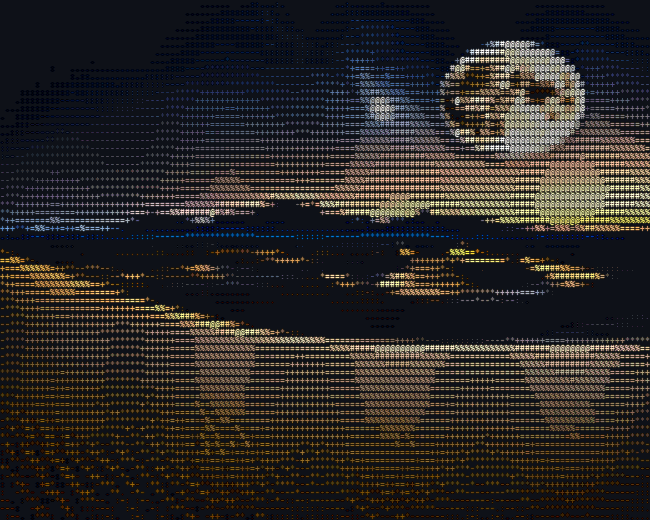
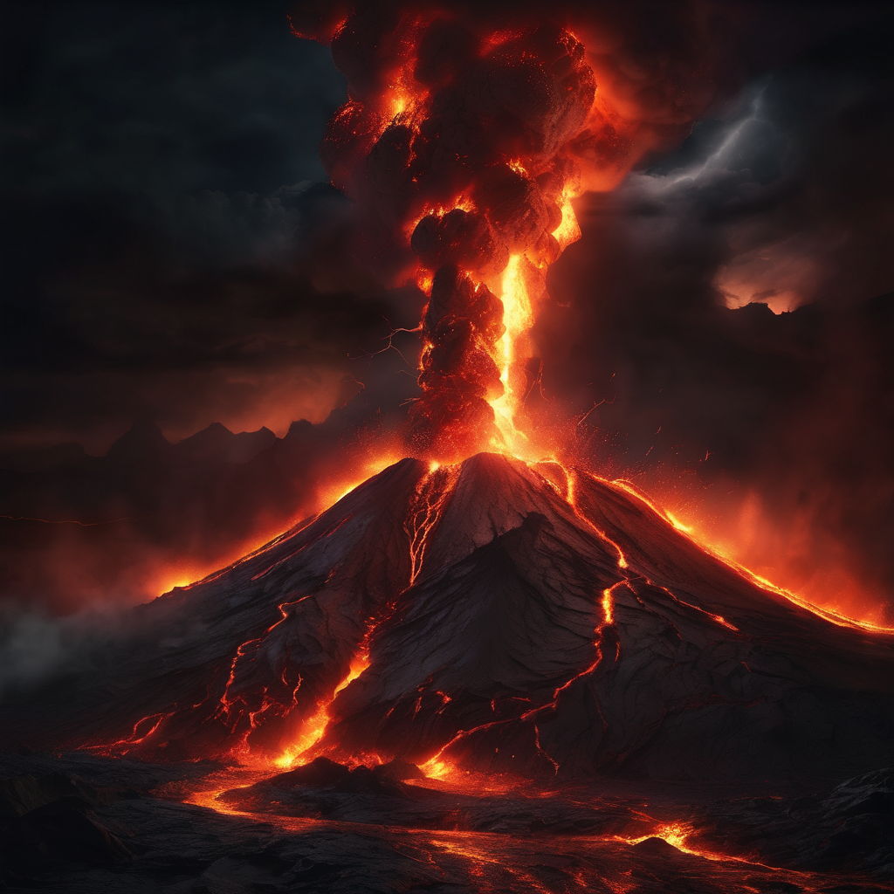
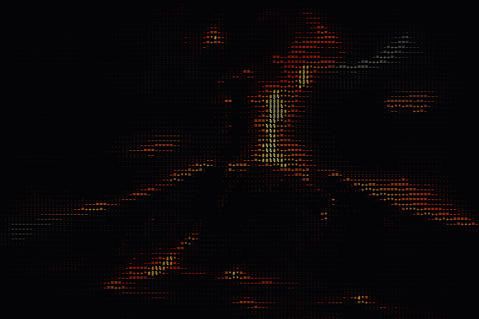
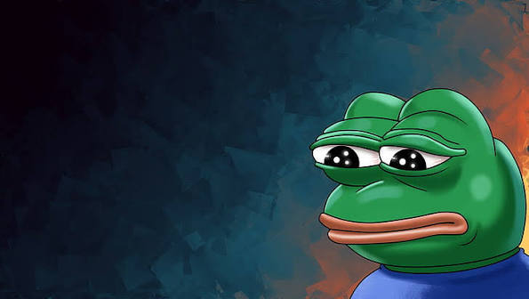
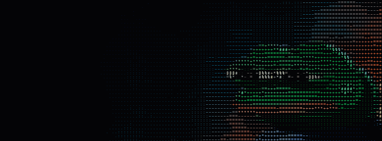

used a text to image model to generate image then custom rendered to ascii

# Visual Comparisons

### Image 1

| Original | ASCII Motion |
| :---: | :---: |
|  |  |

---

### Image 2

| Original | ASCII Motion |
| :---: | :---: |
|  |  |

---

### Image 3

| Original | ASCII Motion |
| :---: | :---: |
|  |  |